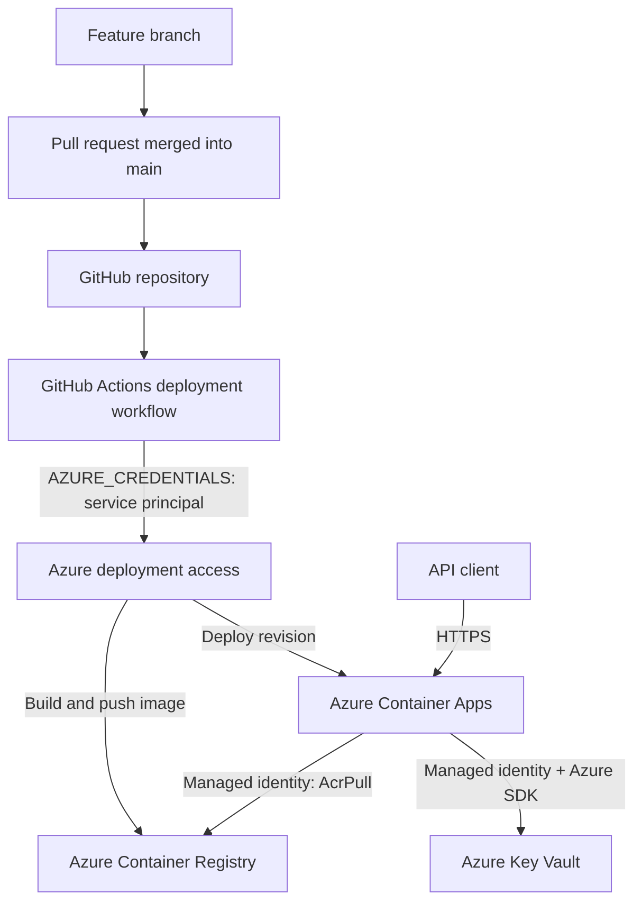

# CI/CD Pipeline with Docker, GitHub Actions and Azure Container Apps

I built a Python FastAPI application, packaged it with Docker and deployed it to Azure Container Apps. I then used GitHub Actions to automate deployments whenever changes were pushed to `main`.

I also worked through managed identity and Azure Key Vault to understand how an application can access Azure services without putting credentials directly into the code.

**Tech used:** Python · FastAPI · Docker · Git · GitHub Actions · Azure CLI · Azure Container Registry · Azure Container Apps · Managed Identity · Azure Key Vault

> **Project status:** Completed as a hands-on learning project. The Azure resources and deployment service principal have since been deleted to avoid ongoing costs, so the application isn't currently hosted. The code, pull requests, screenshots and successful deployment runs are still available here.

## Why I built this

I've worked with Azure and deployments before, but I wanted to understand the full process from writing an application to getting it running in the cloud. More specifically, I wanted to see what Docker, a container registry and a deployment pipeline each do, rather than just follow a set of commands without understanding how they fit together.

I used a [NextWork guided project](https://nextwork.ai/projects/1e465971-014a-4605-a21d-924fcc4cdbc8) as the starting point and completed its Key Vault extension. I also wanted more practice using Git branches and pull requests because they're part of the workflow I use and want to get better at.

## What I built

| Component | What I used it for |
| --- | --- |
| **FastAPI** | A simple Python API with health, item and secret-status endpoints. |
| **Docker** | Packaging the API and its dependencies into a container image. |
| **Azure Container Registry (ACR)** | Storing the container image used for deployment. |
| **Azure Container Apps** | Running the container and exposing the API over HTTPS. |
| **GitHub Actions** | Building and deploying changes pushed to `main`. |
| **Git branches and pull requests** | Making and merging changes without working directly on `main`. |
| **Managed identity** | Giving the running Container App an Azure identity for accessing resources. |
| **Azure Key Vault** | Storing a secret separately from the Python code. |

### Architecture



An important distinction here is that **GitHub Actions and the running application use different identities**:

- **GitHub Actions** authenticated to Azure using a service principal stored in the `AZURE_CREDENTIALS` GitHub secret. It needed deployment permissions.
- **Azure Container Apps** used a managed identity to access Azure resources at runtime. For example, the identity needs the right permissions to pull an image from ACR or read a secret from Key Vault.

Managed identity avoids having to keep an Azure username or password in the application's code. It doesn't remove the need for access controls, though — the identity still needs the right roles or permissions, and these should be kept as limited as possible.

## The application

The API itself is deliberately small. The main thing I wanted to learn was how to containerise and deploy it, rather than build a complicated application.

| Endpoint | Response |
| --- | --- |
| `GET /` | A health response showing that the API is running. |
| `GET /items` | A hardcoded list of sample products. |
| `GET /secret-status` | Whether a Key Vault URL is configured and whether a secret was loaded; it doesn't return the secret. |

Example response from `GET /`:

```json
{
  "status": "healthy",
  "service": "my-fastapi-app"
}
```

The implementation is in [`main.py`](main.py). I added a **Monitor** to the sample products through [pull request #1](https://github.com/Gurpreet-Cloud11/my-fastapi-app/pull/1).

## How I built it

### 1. Set up my environment

I used VS Code, Docker Desktop, Git and Azure CLI. Docker let me run the API as a container locally, while Azure CLI gave me a way to work with Azure resources from the terminal.

These are useful checks before starting the project:

```bash
python --version
docker --version
az version
git --version
```


### 2. Built the API and Docker image

I created the FastAPI app, listed its dependencies in [`requirements.txt`](requirements.txt) and wrote a [`Dockerfile`](Dockerfile) based on `python:3.12-slim`.

The image installs the dependencies and starts the API with Uvicorn on port `8000`. I tested the container locally before moving it to Azure, so I could separate application issues from deployment issues.


### 3. Deployed it to Azure

I created the Azure resources needed to host the application, including a resource group, Azure Container Registry and Azure Container Apps.

ACR stored the image, and Container Apps ran it. I configured external ingress targeting port `8000` so the API could be reached using its Azure HTTPS endpoint.


### 4. Automated deployments using GitHub Actions

This was the part I was most interested in: getting a change from GitHub into Azure without having to manually build and deploy everything again.

My [deployment workflow](.github/workflows/deploy.yml) runs when code is pushed to `main`. It:

1. Checks out the repository.
2. Signs in to Azure using the `AZURE_CREDENTIALS` repository secret.
3. Uses the Azure Container Apps deploy action to build and push the image to ACR.
4. Deploys the updated application to Azure Container Apps.

To test the workflow, I created a feature branch, added a Monitor to the `/items` response and opened a pull request. Once it was merged, GitHub Actions ran and the deployment succeeded.

**Evidence:** [PR #1 — Add Monitor](https://github.com/Gurpreet-Cloud11/my-fastapi-app/pull/1) · [Successful deployment run](https://github.com/Gurpreet-Cloud11/my-fastapi-app/actions/runs/42123325737)


**CI/CD note:** This project automates the build and deployment side of the process, but the workflow doesn't currently run automated tests or security scans. Adding those checks before deployment would be one of my next improvements. I wouldn't describe the current pipeline as fully production-ready.

### 5. Configured managed identity

I looked at how the Container App could pull images from ACR without relying on registry admin credentials. I enabled a system-assigned managed identity and worked with the `AcrPull` role and registry access configuration.

This helped me understand that creating an identity and **granting that identity permission** are two separate steps. The app needs both to access a protected resource.


### 6. Added Key Vault integration

For the final extension, I updated the Python app to use Azure Key Vault. The code uses `DefaultAzureCredential` and `SecretClient` from the Azure SDK and tries to read a secret called `my-api-key` during startup when `KEY_VAULT_URL` is configured.

I added a `/secret-status` endpoint to report whether the secret loaded, rather than expose the secret itself.

The useful part here was understanding the pattern: **the code asks Azure for access using an identity, and Key Vault checks whether that identity is allowed to read the secret**. That's better than hardcoding an API key into `main.py` or committing it to GitHub.

I merged the Key Vault change and GitHub Actions successfully deployed that revision. A successful workflow run confirms the deployment completed; on its own, it doesn't prove that the running app successfully retrieved the secret. The `/secret-status` endpoint is there to check that separately.

**Evidence:** [PR #2 — Key Vault integration](https://github.com/Gurpreet-Cloud11/my-fastapi-app/pull/2) · [Successful deployment run](https://github.com/Gurpreet-Cloud11/my-fastapi-app/actions/runs/42136250868)


## Running it locally

The Azure environment is no longer running, but the API can still be built and tested locally with Git and Docker installed.

```bash
git clone https://github.com/Gurpreet-Cloud11/my-fastapi-app.git
cd my-fastapi-app
docker build -t my-fastapi-app .
docker run --rm -p 8000:8000 my-fastapi-app
```

You can then open:

- `http://localhost:8000/` — health check
- `http://localhost:8000/items` — sample products
- `http://localhost:8000/docs` — interactive FastAPI docs
- `http://localhost:8000/secret-status` — Key Vault configuration and loading status

Without `KEY_VAULT_URL`, the API still runs and `/secret-status` reports that Key Vault isn't configured. Reading a real secret requires an existing vault and an Azure identity with the correct permissions.

## Problems I ran into

The project was straightforward in some places, but I got stuck on the Azure tooling and authentication. These were probably the parts where I learned the most.

### Azure CLI and the Container Apps extension

I was on **Azure CLI 2.75.0**, and the version of the Container Apps extension I tried to install required a newer CLI (**2.79.0 or later**). Another installation attempt also ran into a Python dependency error.

The main lesson was to check version compatibility and the local environment before repeatedly retrying the same extension install. These are the checks I'd use if I hit that problem again:

```bash
az version
az extension list --output table
az extension show --name containerapp
```

That made it clear I needed to sort out the CLI and extension compatibility before carrying on with the deployment.

### Azure login and the missing subscription

I also ran into an issue where `az login` wasn't showing the subscription I expected. In my troubleshooting, the problem was linked to **Windows broker authentication**, and disabling broker sign-in resolved the subscription visibility issue.

The setting involved was `core.enable_broker_on_windows`. Disabling it switches Azure CLI from Windows broker sign-in to browser-based login. These are the commands to repeat that fix and check the active subscription:

```bash
az account clear
az config set core.enable_broker_on_windows=false
az login
az account list --output table
az account show --output table
```

This taught me to check which account and subscription the CLI is actually using, instead of assuming a successful login means I'm working in the right place. Microsoft also documents the [Windows broker sign-in setting](https://learn.microsoft.com/en-us/cli/azure/authenticate-azure-cli-interactively).

### Identity and permissions

Working through ACR image pulls and Key Vault also made the difference between **authentication** and **authorisation** a lot clearer. An identity can exist and authenticate successfully but still fail to access a resource if the relevant permissions haven't been assigned.

## Results and what I learned

By the end of the project, I'd got a FastAPI application running as a container in Azure and confirmed that merging a change into `main` could trigger a successful automated deployment. I also made changes using feature branches and pull requests rather than pushing everything straight to `main`.

The things that made the biggest difference to my understanding were:

- **Docker:** how the image packages the app and its dependencies.
- **ACR vs Container Apps:** where the image lives compared with where it actually runs.
- **GitHub Actions:** how a push can trigger the build and deployment process.
- **Azure identities:** why the deployment workflow and running application should have different permissions.
- **Troubleshooting:** why it's worth checking CLI versions, login context and access permissions before changing the application code.

I spent roughly **three hours** on the original guided project. What made it useful wasn't just getting it deployed — it was having to work through the bits that didn't behave as expected.

## Cleanup and current state

Once I'd finished, I deleted the Azure resource group and the deployment service principal so I wouldn't leave paid resources running unnecessarily.

The repository is kept as a record of the project. **The GitHub Actions workflow still triggers on pushes to `main`, but deployment won't work in its current state** because the Azure resources and credentials no longer exist. If I revisit it, I'd make the deployment job manual or conditional until the environment is recreated.

## What I'd improve next

- Add **pytest** tests and linting so the pipeline checks the code before deploying it.
- Use **GitHub OIDC** for Azure deployment authentication instead of storing a long-lived service principal secret.
- Provision the Azure resources with **Terraform or Bicep** so the environment can be recreated.
- Add container image scanning and improve error handling around Key Vault startup failures.
- Explore **AKS and Kubernetes** as a next step after Container Apps.

## Credit

I followed NextWork's [CI/CD Pipeline with Docker and Azure](https://nextwork.ai/projects/1e465971-014a-4605-a21d-924fcc4cdbc8) project and its Key Vault extension. I've documented the setup, the changes I made, the issues I came across and what I took away from it in my own words.

---

[GitHub](https://github.com/Gurpreet-Cloud11) · [LinkedIn](https://www.linkedin.com/in/gurpreet-singh-0b6568238/)
